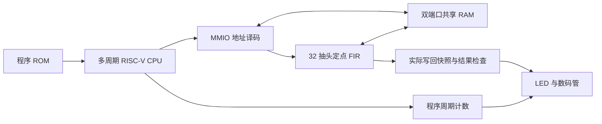

# RISC-V FIR SoC

基于 **Terasic DE2-115** 的自设计多周期 RISC-V CPU 与 32 抽头定点 FIR 加速器。CPU 运行裸机 C，通过 MMIO 配置 FIR；硬件读取共享 RAM、完成滤波并写回，软件与板级监测器检查结果，数码管显示实际输出和程序周期。

当前 CPU 实现 **37 种 RV32I 指令 + MUL**。五级流水线和完整 M 扩展属于后续目标，当前版本不标称完整 RV32IM。

## 从这里开始

| 你要做的事 | 文档 |
| --- | --- |
| 生成工程、编译、下载、使用开关 | [运行指南](docs/quickstart.md) |
| 录实物演示视频 | [拍摄顺序与解说](docs/demo-recording.md) |
| 理解 CPU、RAM、FIR、显示之间的连接 | [系统结构](docs/architecture.md) |
| 查看测试、资源、时序和计时边界 | [验证记录](docs/verification.md) |
| 整理视频并准备 GitHub 发布 | [发布准备](docs/github-publishing.md) |
| 回看 ALU 到系统集成的开发顺序 | [分阶段开发记录](docs/development-history.md) |

**当前实物状态：** 用户已反馈初版 LED 自检与 KEY0 重跑符合预期，数码管新版也反馈可用。完整八个输出、周期和复位的逐项视频正在录制；尚无视频核验记录，见[观察记录](reports/documentation/board-observation.json)。

## 系统结构



## 已实现的内容

- 自行编写的 CPU 数据通路、寄存器组、译码/立即数、控制、字节/半字/字访存和 MUL。
- signed16 Q15 输入/系数、signed40 累加、最近舍入且半格远离零、signed16 饱和的串行 FIR 核。
- 运行时系数配置、MMIO 状态与错误码、双端口共享 RAM、裸机 C 驱动和有限轮询超时。
- 同步程序 ROM、完整 RAM 初值装载、KEY0 重启、实际 DMA 写回检查及输出快照。
- Python 定点参考、独立向量审计、CPU/系统轨迹检查、RTL 故障注入和固定条件下的周期比较。

## 快速运行当前板级版本

Python 3.10+，在仓库根目录执行；生成目录使用英文路径：

```powershell
python -m tools.prepare_de2_display --output C:/fpga/riscv_fir_display
```

随后由使用者在 Quartus 打开生成目录中的 `riscv_fir_de2_display.qpf`，选择 **Processing → Start Compilation**。编译生成的 `output_files/riscv_fir_de2_display.sof` 通过 USB-Blaster / JTAG 下载。生成脚本本身不编译或编程硬件。

参考编译目标为 **EP4CE115F29C7**，输入 50 MHz、实际二分频系统时钟 25 MHz。引脚按 DE2-115 官方手册及参考 JP7=2.5 V、JP6=3.3 V 配置；实际器件及电压应匹配工程，详见[运行指南](docs/quickstart.md)。

| 操作 | 预期数码管内容 | 说明 |
| --- | --- | --- |
| SW3=0，SW2..SW0=000 | 00002000 | 第 0 个输出：8192 |
| SW3=0，SW2..SW0=001 | 00003000 | 第 1 个输出：12288 |
| SW3=0，SW2..SW0=010 | FFFFA800 | 第 2 个输出：-22528，补码显示 |
| SW3=1 | 0000046B | 当前整段自检程序 1131 拍的仿真预期 |
| 按住 / 松开 KEY0 | 空白 / 重跑后恢复显示 | 同时重新装载初始数据 |

正常 LED 状态为 LEDR0/1 亮、LEDR2 灭、LEDR3 闪。完整八个输出见[对照表](docs/quickstart.md#5-操作与预期显示)。演示视频收到后在这里加入真实媒体链接。

## 验证与参考实现

| 层次 | 已有证据 |
| --- | --- |
| 模型/工具 | [213 项 Python 测试、向量审计与重现检查](reports/step1/validation.json) |
| CPU RTL | [188 个程序与受控故障检查](reports/step11-software-fir/validation.json) |
| FIR 核与协同系统 | [核验证](reports/step12-fir-accelerator/validation.json)、[系统验证](reports/step13-fir-soc/validation.json) |
| 数码管版本 | [四次启动/复位、32 项输出选择、六项错误注入](reports/step16-display/simulation-validation.json) |
| Quartus | [实现报告与 SOF 哈希](reports/step16-display/quartus-validation.json) |
| 实物 | 用户反馈已收到；逐项视频与板上性能测量待补 |

数码管版在 Quartus Lite 17.0.0 Build 595 的参考目标上占 **27,451 LE、11,567 寄存器、9,216 逻辑存储位、8 个 9 位乘法器元素**。25 MHz 最差 setup/hold slack 为 **+7.710 / +0.180 ns**，未约束时钟/输入/输出端口计数均为零；15 条普通警告完整保留。这是所声明约束下的参考实现证据，实物与计时结论见[验证说明](docs/verification.md)。

核心 Python 检查只需要标准库，可独立运行：

```powershell
python -m tools.run_step1 --report-dir build/local-check
```

[GitHub Actions 工作流](.github/workflows/reference-model.yml)已配置 Python 3.10/3.12 检查，远端运行结果待实际发布后取得。

## 软件 / 硬件周期对照

以下来自同一 CPU、相同编译器/MUL 能力、相同数据布局和完整调用标记下的 **N=8 功能仿真**：

| 模式 | 完整调用周期 | 软件周期 / 该模式 |
| --- | ---: | ---: |
| 软件 FIR | 2044 | 1.000× |
| 硬件冷调用，含系数配置 | 919 | 2.224× |
| 硬件调用，系数预先驻留 | 392 | 5.214× |

驻留模式的预装成本在区间外另行记录。以上数据与数码管的 1131 拍自检程序属于不同固件/区间，不能直接混算；板上实测加速比尚未取得。完整条件见[计时契约](docs/fir-benchmark-contract.md)和[逐次 CSV](reports/step14-fir-benchmark/comparison.csv)。


## 仓库结构

| 目录 | 内容 |
| --- | --- |
| model/、vectors/ | 无第三方依赖的参考模型、数值向量与清单 |
| rtl/cpu/、rtl/fir/、rtl/soc/ | CPU、FIR、MMIO 和共享 RAM |
| rtl/board/、fpga/ | 板级启动、结果显示、引脚与时钟约束 |
| firmware/、programs/ | C/汇编/链接脚本，以及已编译固件与编译清单 |
| sim/、tests/、tools/ | Testbench、Python 检查与工程生成/收集工具 |
| docs/ | 当前指南、设计契约、开发记录和发布材料 |
| reports/ | 各阶段原始日志、测量与哈希记录 |
| artifacts/ | 数值/周期图表及待整理的演示媒体 |

## 当前边界与后续方向

当前为多周期 CPU，没有五级流水线、完整 M 扩展、CSR/标准异常处理、Cache 或实时音频链。共享 RAM 当前推导为寄存器与选择逻辑，进一步优化存储推导和流水线都需要重新验证。

下一阶段先补齐本版实物视频和逐项观察记录，再推进 CPU 流水线及更长数据块的成组性能实验。[项目规格](docs/project-spec.md)中的五级流水线、更大存储及扩展接口为目标设计。

## 来源与许可证

实现、规范与工具依赖的边界见 [THIRD_PARTY.md](THIRD_PARTY.md)。当前没有 LICENSE 文件，项目许可证尚未选定；发布准备项见[说明](docs/github-publishing.md)。
