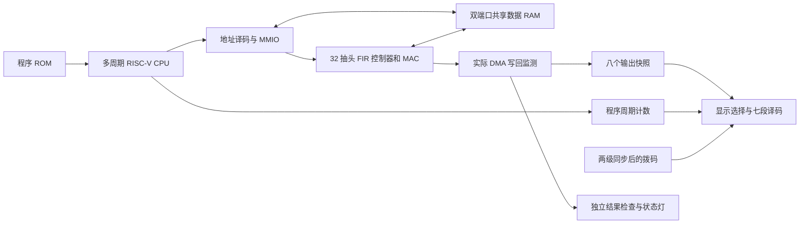

> 本页保留 step22 整理前的开发记录，数字和待办按当时阶段解读。当前入口见[项目首页](../README.md)。

# 当前系统结构

这里先保留第十六步多周期 CPU 与 FIR 的结构说明。五级流水线 SoC 已在[第十八步](step18-pipeline-soc-guide.md)通过 25 MHz 实现检查，并获用户板上结果正确的反馈。两版共用 FIR 数值规则、MMIO 页和共享 RAM，但有不同的 CPU 与终端监测逻辑。[第十九步](step19-parallel-fir-guide.md)又为 FIR 加入编译期 1/2/4 路并行选择，CPU 和软件接口保持一致。完整 M 扩展、CSR/标准异常环境和实时音频属于后续工作。

## CPU 与 C 固件

- 32 位寄存器和数据通路，32 个架构寄存器，x0 固定为 0。
- 当前支持 37 种 RV32I 指令和 MUL，共 38 种；大多数指令三拍、load 四拍。
- 已支持算术/逻辑、移位比较、条件分支、JAL/JALR、LUI/AUIPC、字/半字/字节访存。
- MUL 写回乘积低 32 位。未实现除法、高位乘法等完整 M/Zmmul 指令集。
- 教学用 FAULT 终止无效指令/访问；没有标准 trap handler、CSR 或中断环境。
- 裸机 C、启动汇编、链接脚本和 ELF 装载遵循当前 ILP32 环境，固件产物和编译命令保存在 programs/ 的清单中。

精确行为以 [CPU 契约](tiny-cpu-contract.md)为准。

## 存储与 MMIO

| 区域 | 当前范围 | 用途 |
| --- | --- | --- |
| 指令 ROM | 独立地址空间 0～1023 字节 | 256 个 32 位指令字，未用处填 NOP |
| 共享数据 RAM | 数据地址 0～1023 字节 | CPU A 端口，FIR B 端口 |
| FIR MMIO | 0x40003000～0x40003FFF | 仅对齐 LW/SW，控制/状态/地址/计数和系数 |

RAM 同步读；CPU 端口支持字节使能，FIR 端口整字读写。输入和输出缓冲必须互不重叠且在 RAM 内。每个 Q15 样本或系数用一个符号扩展的 32 位字存放。

常用寄存器相对 FIR 基址：CONTROL=0x00、STATUS=0x04、SRC_ADDR=0x08、DST_ADDR=0x0C、SAMPLE_COUNT=0x10、CYCLES=0x14、WRITTEN=0x18，32 个系数位于 0x100～0x17C。详细错误及 BUSY 期间访问规则见 [MMIO 契约](fir-mmio-contract.md)。

当前 Quartus 把共享 RAM 实现为寄存器和选择逻辑；两块 M9K 来自程序及初值 ROM。后续改善 RAM 推导时须重新验证双端口读写、字节使能和冲突语义。

## FIR 数值语义

- 32 抽头串行 MAC，输入和系数为 signed16，15 位小数。
- 乘积 signed32，累加器 signed40。
- 最终右移 15 位前按最近整数舍入，半格远离零，再饱和到 signed16。
- 每次 START 清历史，块前样本视为 0；输出长度等于输入长度，不输出卷积尾部。
- 只有最后一个输出实际被 RAM 接受后才置 DONE。DMA 等待期间保持请求参数稳定。

数值定义见[定点契约](numeric-contract.md)，核的逐拍行为见 [FIR 核契约](fir-accelerator-contract.md)。

## 启动、计时和显示

板载 50 MHz 经真实二分频产生 25 MHz 系统时钟。KEY0 异步进入两级复位链，按系统时钟释放。装载器每次重载全部 256 个 RAM 字，再释放 CPU 运行已有 C 驱动。

板级监测器对实际接受的八次 DMA 写回检查地址、顺序和完整数据，也检查 C done/errors 与 CPU FAULT。正常结束后保持结果，KEY0 清状态并重新装载。

显示快照来自实际 DMA 写数据。SW2..SW0 选择输出编号，SW3 选择程序计数；机械开关只改变观察选择，不控制计算。两级同步后的各位在切换期间允许短暂出现中间选择。

数码管显示的是 32 位十六进制；HEX0 为最低四位，HEX7 为最高四位。内部完整程序计数包括配置、等待和检查，当前仿真为 1131 拍。它与 FIR 内核计数及基准标记区间分别定义，见[验证记录](verification.md)。
