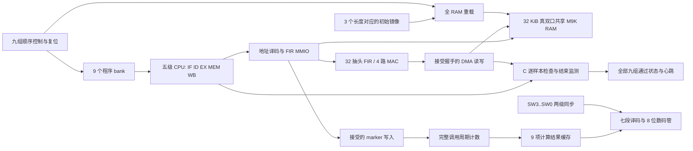

# 当前五级 CPU + FIR 系统结构

当前展示版本为 step21 九组计时。CPU、FIR 和 M9K 通路沿用 step20 r1；新增 ROM bank、顺序运行控制、接受沿计数器与九项结果缓存。[旧多周期说明](architecture-v0.1.md)保留作历史参考。

CPU 支持 37 种 RV32I 指令与 MUL。旁路、load-use 暂停、分支/跳转清空与存储等待在[流水线契约](pipeline-cpu-contract.md)中定义。非法指令或访问进入项目的 FAULT 状态；当前没有标准 trap/CSR 环境。

## 存储与接口

| 通路 | 已实现范围 |
| --- | --- |
| 指令 | 每个 bank 为 1 KiB；九个 bank 由板级控制切换，CPU 的可见 PC 地址范围仍为 1 KiB |
| 数据 | 独立数据地址 0..32767，共 8192 个 32 位字 |
| FIR MMIO | `0x40003000` 页；START、STATUS、地址、长度、系数、硬件计数 |
| CPU / FIR RAM 端口 | CPU 为 A、FIR/DMA 为 B；同字冲突有写入时 A 优先，B 等待 |
| 调用计数 | 板级监听数据 RAM 的 marker=1/2 接受沿；独立计时器 MMIO 页和 `mcycle` CSR 未实现 |

两端口同钟，读延迟按实际 M9K 模型验证。复位取消 DMA；存储阵列由装载器重新初始化，不能将中途复位的半块输出当作完成结果。每个任务的输入、输出和状态布局由对应 ELF 符号表及生成清单确定。

板载 50 MHz 二分频为 25 MHz，SDC 建立真实主从时钟关系。异步 KEY0/SW 的同步器入口与人机 LED/HEX 输出例外范围单独限定。SW 多位切换不作为业务命令，只选择已经完成的稳定计数；计算顺序与开关位置无关。

## 一次运行

1. 选定长度与软件/冷调用/驻留模式，装载全部 8192 字 RAM，复位 CPU/FIR。
2. CPU 从当前程序 bank 启动；驻留模式先装好 32 个系数。
3. 接受 marker=1 后计数；软件执行 C FIR，或由 C 配置并等待硬件完成。
4. 接受 marker=2 后冻结计数；C 校验该块所有输出，板级监测器检查事务及结束状态。
5. 成功后缓存本组计数并进入下一组；任一组失败显示 EEEEEEEE。全部九组成功才置完成标志。

具体 RTL 见 `rtl/cpu/pipeline_large_cpu.vhd`、`rtl/soc/pipeline_large_soc.vhd`、`rtl/soc/shared_ram_m9k.vhd`、`rtl/fir/fir_mmio_large.vhd`、`rtl/fir/fir_serial.vhd`、`rtl/board/call_cycle_timer.vhd` 和 `rtl/board/de2_115_benchmark_top.vhd`。
