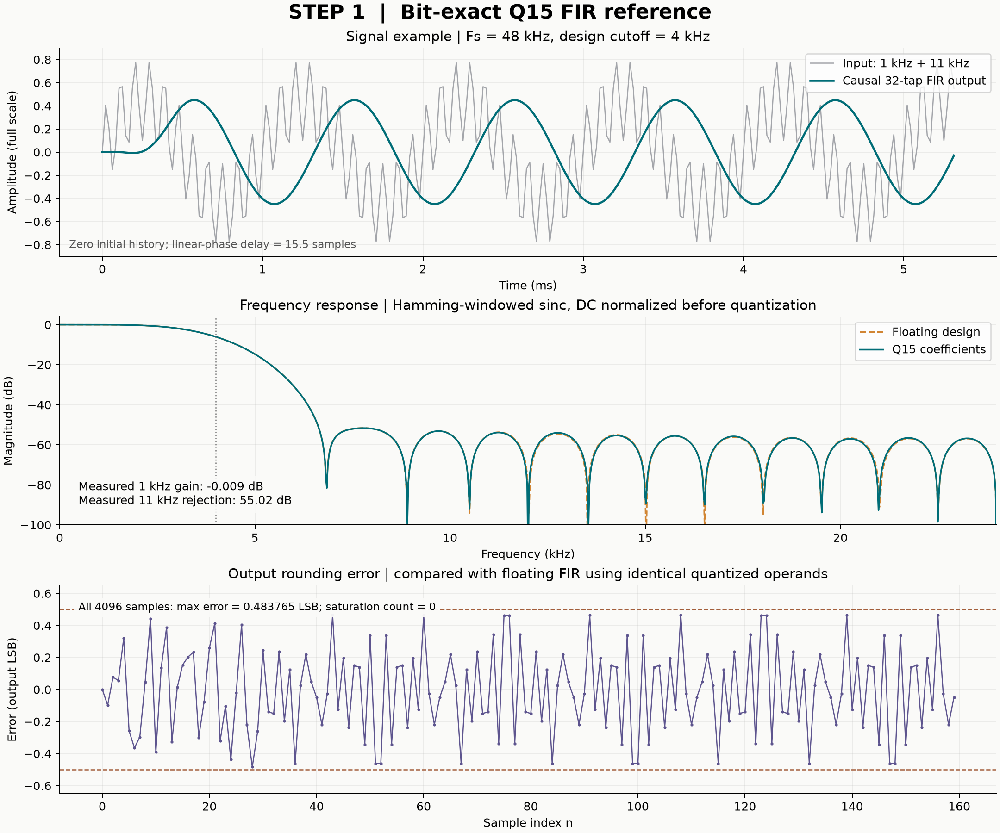

# 分阶段开发记录

本页保存整理前的 README，供回看开发顺序和历史测试数字。当前运行入口、验证状态与未完成事项以[项目首页](../README.md)、[运行指南](quickstart.md)和[验证记录](verification.md)为准。历史阶段的“尚未上板”等描述不代表最新状态。

# RISC-V FIR SoC

面向 Terasic DE2-115 的自设计 RISC-V CPU 与定点 FIR 加速器项目。

**当前阶段：第十六步——数码管显示实际 FIR 输出和程序周期，新工程已通过仿真与 25 MHz 实现检查。** 第一版 LED 自检及 KEY0 重跑已由用户反馈符合预期。新版用 SW0～SW2 选择八个输出，SW3 切换程序周期；新增显示尚待用户上板观察。参考器件为 `EP4CE115F29C7`，完整芯片丝印仍待读清；照片中的 JP7=2.5 V、JP6=3.3 V 已用于参考约束。CPU 当前支持 37 种 RV32I 指令加 MUL，流水线仍为后续目标。

目标是实现五级流水线 CPU、共享片上存储器、可编程 FIR 加速器及裸机 C 软件，并以一致的数值语义比较 CPU 软件与硬件加速两条路径的正确性、完整处理时间和资源开销。

## 在板上查看结果与周期

[第十六步操作说明](../docs/step16-display-guide.md)给出新 SOF 路径和全部八个显示值。下载 `de2_115_display/output_files/riscv_fir_de2_display.sof` 后，SW3=0、SW2..SW0=000 时应显示 `00002000`；SW3=1 时仿真预期显示 `0000046B`（整段自检程序 1131 拍，排除初值装载）。显示值来自实际接受的 DMA 写回，负数保留 32 位符号扩展。

[显示仿真](../reports/step16-display/simulation-validation.json)包含四次完整运行、32 项输出选择及六项故障注入；[Quartus 实现](../reports/step16-display/quartus-validation.json)占用 27,451 LE，25 MHz 最差 setup/hold 余量 +7.710/+0.180 ns。原 LED 工程保留在原目录，当前新版不自动编程硬件。

## 打开 Quartus 工程

本机在 Quartus 的 **File → Open Project** 中打开 `F:\CodexWorkspace\outputs\riscv-fir-soc\de2_115\riscv_fir_de2_115.qpf`，再选择 **Processing → Start Compilation**。初次只做电脑端编译，具体操作见[第十五步说明](../docs/step15-quartus-guide.md)。其他机器先运行 `python -m tools.prepare_de2_project --output <英文工程目录>`，再打开生成目录中的 QPF。

Quartus Prime Lite 17.0 参考实现占用 26,980 个 LE、11,271 个寄存器、9,216 个逻辑存储位和 8 个 9 位乘法器元素。板载 50 MHz 经寄存器真实二分频生成 25 MHz；已分析角落的最差 setup/hold slack 分别为 +7.131 ns、+0.180 ns，未约束时钟/输入/输出计数均为零。报告保留普通警告及 I/O 限制，不能作为实物电气或板上功能确认。

[实现验证与源码哈希](../reports/step15-quartus/quartus-validation.json)、[原始 Quartus 报告](../reports/step15-quartus/quartus/)、[四次启动/复位仿真及三项故障注入](../reports/step15-quartus/boot-validation.json)已保存；当前完整 Python 检查为 212 项通过。首次 50 MHz 尝试的时序失败也单独归档，未作为通过结果。

## 运行完整调用周期对照

```tcl
do {F:/CodexWorkspace/outputs/riscv-fir-soc/benchmark/baseline/run_benchmark_gui.do}
```

[第十四步说明](../docs/step14-fir-benchmark-guide.md)解释同一 C 源文件、同一编译器/MUL 能力、同一初始 RAM、同一计时标记如何构成配对对照。42 个实际 ModelSim 测量对应七组数据、三种模式、两种等待策略，全部逐项检查输出、CPU 提交、实际 RAM/DMA 事务和最终 RAM/寄存器；8 项真实日志的测量/数值负例全部被拒绝。[完整验证](../reports/step14-fir-benchmark/validation.json)、[逐次数据](../reports/step14-fir-benchmark/measurements.json)、[CSV](../reports/step14-fir-benchmark/comparison.csv)及[编译复现](../reports/step14-fir-benchmark/compiler-reproducibility.json)均保留。

第十四步当时的 207 项 Python 测试通过；三种模式的 15 项编译产物在两个独立构建目录中逐字节重现。新旧系统 GUI 宏完成四次加载、三次设计切换，并两次直接读回正确的有符号 RAM 输出，见[加载验证](../reports/step14-fir-benchmark/gui-switch.json)。

| 基准八样本，无额外 DMA 等待 | 完整调用周期 | 软件 / 该模式 |
| --- | ---: | ---: |
| 软件 FIR | 2044 | 1.000× |
| 硬件冷调用，含全部系数配置 | 919 | 2.224× |
| 硬件调用，系数事先驻留 | 392 | 5.214× |


这是固定 N=8 的功能仿真周期比较。硬件两种固件的整段程序都执行 997 拍；392 拍仅是预配置后的调用，预装成本没有消失。内部任务 297 拍也不能替代完整冷调用的 919 拍。第十五步综合的是独立 C 自检固件及其启动顶层，并未把这些周期比升级为板上加速结果。[计时契约](../docs/fir-benchmark-contract.md)与[完整数据表](../reports/step14-fir-benchmark/comparison.json)限定结论范围。

## 运行 CPU 与 FIR 协同系统

```tcl
do {F:/CodexWorkspace/outputs/riscv-fir-soc/soc/baseline/run_soc_gui.do}
```

[第十三步说明](../docs/step13-cpu-fir-soc-guide.md)展示真实 C 配置、START、轮询和硬件写回。正常结束时 FIR_STATUS=2、HW_written=8、C_done=1、C_errors=0，八个输出与软件参考一致。当前验证包含 9 个系统用例（8 个成功完成、1 个主动超时）、20 个外设用例和 11 个 CPU 地址专项；15 项故意引入的 RTL 错误均被发现。[接口契约](../docs/fir-mmio-contract.md)、[C 驱动](../firmware/c_fir_accel/main.c)、[系统验证报告](../reports/step13-fir-soc/validation.json)与[加载切换/真实 RAM 读回](../reports/step13-fir-soc/gui-switch.json)已保存。

第十三步通过 186 项 Python 测试；原有 188 个 CPU 程序及 26 项 CPU/初始化故障检查也通过。该阶段 C 驱动在两个独立构建目录中生成的五项产物逐字节一致，见[编译复现记录](../reports/step13-fir-soc/compiler-reproducibility.json)。

## 单独运行 FIR 运算核

```tcl
do {F:/CodexWorkspace/outputs/riscv-fir-soc/fir_accel/baseline/run_fir_accel_gui.do}
```

[第十二步说明](../docs/step12-fir-accelerator-guide.md)展示每个样本的 32 次串行乘加、输出暂停和八个实际输出。[接口契约](../docs/fir-accelerator-contract.md)规定精确延迟、块边界与复位规则。运算核的 24 组 ModelSim 用例检查 1855 个正常样本、44 个协议专项输出和 2772 拍输出等待；12 项故意引入的 RTL 错误全部被断言捕获。已保存[验证报告](../reports/step12-fir-accelerator/validation.json)和[设计切换/实际输出读回记录](../reports/step12-fir-accelerator/gui-switch.json)。

这些运算核与周期对照数据来自功能仿真；参考综合和时序见第十五步，当前没有资源优势或板上加速声明。

## 运行 CPU 软件 FIR

```tcl
do {F:/CodexWorkspace/outputs/riscv-fir-soc/tiny_cpu/baseline/run_fir_gui.do}
```

[第十一步说明](../docs/step11-software-fir-guide.md)连接 CPU、C 编译和 DSP 数值参考。基准输出为 8192、12288、−22528、17408、−12288、15360、−7680、−2048；另检查冲激、半格舍入、正负饱和与跨 32 位累加。[C 源码](../firmware/c_fir_q15/main.c)、[编译清单](../programs/c_fir_q15/manifest.json)、[验证报告](../reports/step11-software-fir/validation.json)已保存，继续作为软件比较基线。

[第十步的 C 数组求和](../docs/step10-c-program-guide.md)、[第九步的字节与半字读写](../docs/step9-subword-guide.md)、[第八步的常量与地址](../docs/step8-upper-immediate-guide.md)、[第七步的循环求和](../docs/step7-control-flow-guide.md)、[第六步的读写示范](../docs/step6-memory-guide.md)、[第五步的移位/比较示范](../docs/step5-alu-isa-guide.md)和[第四步的三指令示范](../docs/step4-cpu-guide.md)继续可用。当前 CPU 的精确范围见 [执行通路契约](../docs/tiny-cpu-contract.md)：对非法指令或访问进入教学用 FAULT，尚未实现标准异常处理机制。

第十一步 CPU 基线验证通过 188 个 ModelSim 程序和 27 次加载切换；核对 6376 次提交、1000 笔 CPU RAM 请求和 311 次 MUL。24 项 RTL 故障与 2 项固件初始化故障全部被发现；该报告的源码哈希在当时加载切换前重新核准。该阶段证据为功能仿真，后续参考综合见第十五步。

```sh
python -m tools.run_cpu --modelsim-bin E:/quartus/modelsim_ase/win32aloem --build-dir F:/CodexWorkspace/outputs/riscv-fir-soc/tiny_cpu
python -m tools.check_modelsim_switch --include-cpu
```

## 在 ModelSim 里运行寄存器组

```tcl
do {F:/CodexWorkspace/outputs/riscv-fir-soc/regfile32/baseline/run_regfile_gui.do}
```

[第三步说明](../docs/step3-regfile-guide.md)给出了从 15 ns 写入 x1=5 开始的波形阅读方法。两个读口会在每个测试周期的上升沿前后自动检查；具体计数、源码哈希和故障注入证据见 [寄存器组验证报告](../reports/step3-regfile/validation.json)。

```sh
python -m tools.run_regfile --modelsim-bin E:/quartus/modelsim_ase/win32aloem --build-dir F:/CodexWorkspace/outputs/riscv-fir-soc/regfile32
```

## 在 ModelSim 里运行 ALU

本机窗口底部 Transcript 输入：

```tcl
do {F:/CodexWorkspace/outputs/riscv-fir-soc/alu32/baseline/run_alu_gui.do}
```

详细操作与波形解释见 [第二步说明](../docs/step2-alu-guide.md)。RTL 支持十种运算，使用 4880 条向量自动比对，并以 SRA 故障注入检查断言是否能发现错误。[ALU 验证报告](../reports/step2-alu/validation.json)记录具体源码哈希和运行结果；本阶段没有综合或上板数据。

可复现的批处理命令（模型路径和工具目录可调整）：

```sh
python -m tools.run_alu --modelsim-bin E:/quartus/modelsim_ase/win32aloem --build-dir F:/CodexWorkspace/outputs/riscv-fir-soc/alu32
```

## 立即运行第一步

Python 3.10+，核心模型与检查仅使用标准库。在项目根目录运行：

```sh
python -m tools.run_step1
```

该命令执行完整测试、检查向量是否能逐字节重现、用独立有理数实现审计结果，并确认三种故意引入的错误会被测试抓住。结果记录在 [验证报告](../reports/step1/validation.json) 和 [测试日志](../reports/step1/unit-tests.log)。这些记录是本地数值验证证据，不包含硬件性能测量。

- [第一步学习与运行说明](../docs/step1-guide.md)
- [数值契约 fir-q15-block-v1](../docs/numeric-contract.md)
- [测试向量清单及 SHA-256](../vectors/manifest.json)

```python
from model.fixed_fir import fir_block

x = [16384, 8192, -8192, 0]                    # [0.5, 0.25, -0.25, 0]
h = [16384, -8192, 4096] + [0] * 29          # [0.5, -0.25, 0.125, ...]
assert fir_block(x, h).outputs == (8192, 0, -4096, 3072)
```

可选图形演示需要 Matplotlib：

```sh
python -m pip install -r requirements-visualization.txt
python -m tools.plot_demo
```



图中为 Python 数值示例：48 kHz 采样率，1 kHz 与 11 kHz 混合输入，32 抽头低通。原始数据、系数与测量边界见 [JSON](../artifacts/step1/demo_metrics.json) 和 [CSV](../artifacts/step1/demo_samples.csv)。

## 当前目录

| 目录 | 内容 |
| --- | --- |
| `model/` | 无第三方依赖的 FIR、ALU、寄存器组与指令子集参考模型 |
| `rtl/cpu/` | ALU、寄存器组、译码/立即数、CPU 与同步数据 RAM 的 VHDL-93 源码 |
| `rtl/fir/` | 独立 32 抽头串行 MAC FIR 核 |
| `rtl/soc/` | CPU/FIR 地址译码与双端口共享 RAM |
| `rtl/board/` | 自动启动、复位同步、结果检查与 LED 顶层 |
| `fpga/de2_115/` | 可生成完整工程的 Quartus 项目、引脚与时钟约束模板 |
| `firmware/` | 裸机 C、启动汇编和链接脚本 |
| `programs/` | 汇编示范及已编译 C 的 ELF、ROM/RAM 镜像和编译清单 |
| `sim/` | testbench、ModelSim 脚本及可生成的仿真向量 |
| `tests/` | 算术、滤波、导出/损坏检测、故障注入及示例信号检查 |
| `tools/` | 向量生成、独立审计、完整检查与可选绘图工具 |
| `vectors/` | 13 组可复现输入、系数、期望输出、累加器及轨迹 |
| `docs/` | 项目规格、数值契约和学习说明 |
| `artifacts/step1/` | 数值示例图及可审计数据 |
| `artifacts/step14/` | 基于实际周期报告的 PNG/SVG 对照图与绘图来源哈希 |
| `reports/` | 各阶段模型/RTL 检查报告、加载切换记录与对应日志 |
| `.github/workflows/` | Python 3.10/3.12 的 CI 配置，远端运行待发布后验证 |

## 核心交付物

- 自行编写的 CPU 数据通路、控制器、旁路、暂停和清空逻辑。
- 分阶段实现 RV32I、M 扩展；逐项公布已实现及已验证的范围。
- 32 抽头、16 位有符号输入/系数、40 位累加的 FIR 加速器。
- 内存映射控制寄存器、共享 RAM 块处理、裸机 C 驱动。
- Python 定点参考模型、模块测试、CPU 提交轨迹比对和系统回归。
- 固定条件下的软件/硬件性能对比、Quartus 资源与时序报告。
- DE2-115 板级工程、构建说明和真实演示记录。

## 目标平台与环境

- 板卡：Terasic DE2-115，用户提供的照片已确认板名。
- FPGA：Cyclone IV E，EP4CE115；完整封装/速度等级及板卡修订尚待核准。
- 已运行版本查询：Quartus Prime Lite 17.0.0 Build 595；ModelSim Altera Starter Edition 10.5b。
- Quartus 安装内发现 `cycloneive` 器件支持目录；已完成原 LED 及新增数码管工程的综合、布局布线和时序检查。
- 当前基础 CPU RTL 使用 VHDL-93。

## 规格与实施顺序

详见 [项目规格](../docs/project-spec.md)。

1. 建立定点数值契约、软件参考与测试向量（当前实现）。
2. 完成 CPU 功能与流水线验证，运行裸机 C 程序。
3. 完成串行 MAC FIR、共享 RAM 和驱动，比较完整处理时间。
4. 扩展 MAC 并行度，分析面积、主频与加速比的关系。
5. 整理上板结果；音频接口作为后续扩展。

## 外部参考

外部指令集规范、模拟器和测试框架将作为规范或验证依赖记录。若后续复用任何代码，须保留来源及其许可证，并明确复用范围。

当前来源及依赖边界见 [THIRD_PARTY.md](../THIRD_PARTY.md)。

- [Terasic DE2-115 规格](https://www.terasic.com.tw/cgi-bin/page/archive.pl?CategoryNo=168&Language=English&No=502&PartNo=2)
- [RISC-V RV32I](https://docs.riscv.org/reference/isa/v20260120/unpriv/rv32.html)
- [RISC-V M 扩展](https://docs.riscv.org/reference/isa/v20240411/unpriv/m-st-ext.html)
- [Spike ISA 模拟器](https://github.com/riscv-software-src/riscv-isa-sim)
- [RISC-V 架构测试](https://github.com/riscv/riscv-arch-test)

目前仅公布明确条件下的功能仿真周期数字，没有板级性能或兼容性认证声明。许可证尚未选定；在用户明确选择前不自动添加 LICENSE。


## 第十九步：可配置 FIR 并行度（2026-10-29）

用户已确认 step18 板上结果正确，实际编译报告、原始源码快照对应关系及反馈原话已归档。随后实现 1/2/4 路 FIR 并行乘加，保留相同五级 CPU、软件二进制、数值规则和总线接口。核级覆盖 72 场景、5565 个主流输出，MMIO 独立覆盖重复任务、非法配置、等待写回与复位；系统执行 126 次匹配基准。base 无额外等待时的软件基线 769 拍，单/双/四路冷调用为 590/462/398，系数驻留为 331/203/139。三种板级配置的四次启动/复位及实际输出显示仿真通过，整段自检分别 694/562/502 拍。

交付独立工程和图表；随后同版 p1/p2/p4 均由用户编译并通过 25 MHz 时序，p4 用户反馈上板符合预期。step19 尚未上传 GitHub。见[第十九步指南](step19-parallel-fir-guide.md)与[并行契约](parallel-fir-contract.md)。

## 第二十步：32 KiB M9K 与长块 C 调用（2026-10-29）

另建 CPU、MMIO、RAM 和板级实体，保留旧工程与 SOF。64/256/1024 点三模式三并行度及 DMA 等待共 45 次 C 执行，全部回放 ISA、总线/DMA 及最终 32 KiB RAM 和寄存器。1024 点软件 489233 拍、四路冷调用 13608 拍、驻留 13349 拍。存储全地址、17 个 CPU 地址场景、最大 4096 点 MMIO、四次整板复位和受控故障通过；破坏第 1024 个输出时触发 C 错误和板级错误显示。候选计数 24917 拍，用户编译/上板待补。见[第二十步指南](step20-large-block-guide.md)。

## Step20～22：长块、板上计时与项目展示

step20 加入 32 KiB 真双口 M9K 与 64/256/1024 点 C 基准，修复 Quartus 17 组件绑定后完成用户编译和上板接受。step21 在同一镜像执行九组调用，由实际标记接受沿计数，完成四次扫描、故障控制及用户 Quartus/上板反馈。step22 汇总当前架构、运行说明、周期/资源图表及发布审阅包，保留旧版入口与源代码。精确周期标为仿真值，用户概括接受与独立逐项实测分列；后续 GitHub 发布需要新增授权。
