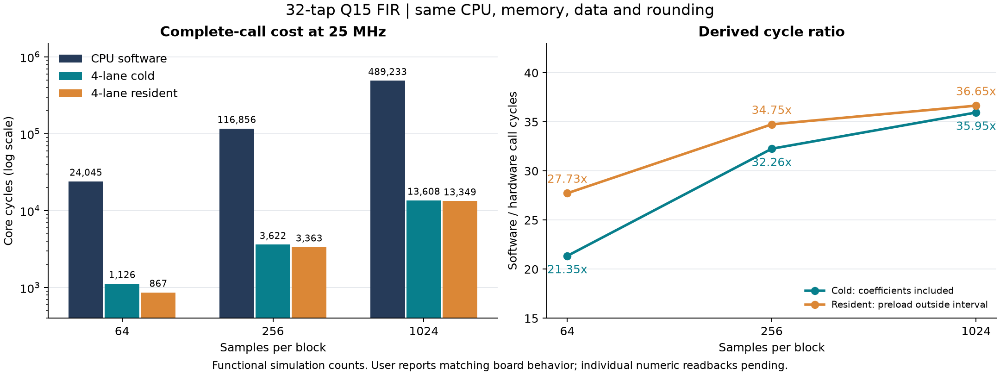
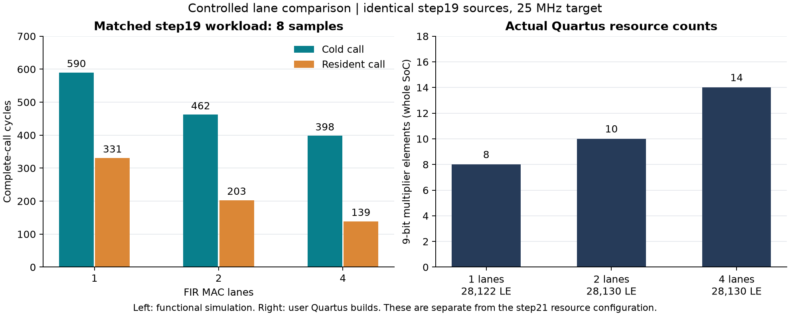

# 软件与 FIR 加速器：性能、资源与证据

本页针对当前已经实现并验证的 CPU + FIR 软硬件协同系统。用户已确认 step21 下载后行为符合预期；精确数字仍以 RTL 仿真和 Quartus 原始报告为来源，逐项独立板上读数尚未抄录。

## 1. 比较条件

- 同一自设计五级 CPU 与 MUL 能力，同一块 DE2-115 参考目标，核心目标时钟 25 MHz。
- 相同 32 抽头、16 位 Q15、40 位累加、舍入及饱和；每块初始历史清零。
- 三种模式使用相同长度的初始 RAM；每次换模式重新装载 RAM、复位 CPU/FIR。
- CPU 在共享 RAM 写 marker=1/2，板级计数器监听实际接受沿，区间为二者的时钟沿差。
- 冷调用包含系数配置、START、轮询、必要 DMA 搬运；驻留模式将 32 个系数的配置移到区间外。两种模式都保留配置证据。
- 启动、完整 RAM 装载、结果逐项校验和 marker=2 后的诊断读取不在区间内。它们没有消失，完整应用时延应另行测量。

## 2. 三种块长、固定四路

| 点数 | 软件周期 | 四路冷调用周期 | 四路驻留周期 | 软件/冷调用 | 软件/驻留 |
| ---: | ---: | ---: | ---: | ---: | ---: |
| 64 | 24,045 | 1,126 | 867 | 21.35× | 27.73× |
| 256 | 116,856 | 3,622 | 3,363 | 32.26× | 34.75× |
| 1024 | 489,233 | 13,608 | 13,349 | 35.95× | 36.65× |



以上是[step21 板级仿真](../reports/step21-board-benchmark/validation.json)计数，也与[step20 同条件 C 调用](../reports/step20-large-block/comparison.json)逐项一致。25 MHz 下，1024 点软件/冷调用/驻留区间分别为 **19.56932 / 0.54432 / 0.53396 ms**，是由周期除以目标频率换算，未使用外部仪器计时。

冷调用与驻留相差 259 拍，三种块长均如此。在本组程序和轮询边界下，预配置成本对短块的占比更高；随着块长增大，该固定差值被更多样本摊薄。驻留模式的预装成本仍需在完整应用预算中计入。

1024 点四路硬件内部 kernel 为 13,313 拍，完整冷调用为 13,608 拍；内核计数、C 完整调用与 step20 的 24,917 拍整段自检采用不同区间，不能互相替代。1,024 点冷调用约 35.95× 的比值仅相对于本项目这份 CPU/C 基线，未与商用 CPU 或外部 RISC-V 核作比较，也未建立长期连续流吞吐结论。

## 3. 同版 1/2/4 路资源与调用比较

以下来自 **step19 同版 N=8** 的受控实验。25 项源码输入一致，三项用户 Quartus 编译使用同一器件、工具和 25 MHz 约束。该实验的 RAM/顶层与 step21 不同，独立成表。

| MAC 路数 | 冷调用周期 | 驻留周期 | LE | 9 位乘法器元素 | setup / hold 余量 ns |
| ---: | ---: | ---: | ---: | ---: | ---: |
| 1 | 590 | 331 | 28,122 | 8 | +11.572 / +0.145 |
| 2 | 462 | 203 | 28,130 | 10 | +10.152 / +0.152 |
| 4 | 398 | 139 | 28,130 | 14 | +11.166 / +0.119 |



四路相对单路的完整冷调用缩短 590/398≈1.48 倍，驻留调用缩短 331/139≈2.38 倍。四个 MAC 通道并不意味着完整处理时间恰好缩短四倍：配置、轮询、数据供给和写回仍占用时间。表中的乘法器元素是全 SoC 统计，包含 CPU MUL，不能解释为 FIR 通道数。

## 4. 当前板级版本的实际实现

step21 实际使用 14,171 LE、3,778 寄存器、262,144 存储位、32 M9K、14 个 9 位乘法器元素。32 个 M9K 均为 8192×32 同钟真双口共享 RAM；Fitter 没有单列 M9K ROM。四个 FIR 乘法通道保留。三个工况 18 项 setup/hold/脉宽检查非负，最差 +10.184/+0.181 ns，未约束摘要全零，66 个实际引脚的位置及 I/O 标准匹配。

[原始实现报告与警告分类](../reports/step21-board-benchmark/quartus-validation.json)保留了工具版本、源码和 SOF 哈希。与 step20 的 LE/M9K 差异同时涉及程序镜像、ROM bank 和顶层控制，不属于单变量面积实验。

## 5. 上板与来源

[用户观察记录](../reports/step21-board-benchmark/board-observation.json)保留原话“ok，符合预期，继续吧”，作为已下载版本行为的概括接受。九项独立数字抄录、Programmer 日志、视频和外部仪器计时尚未提供；[CSV 模板](../reports/step21-board-benchmark/board-measurement-template.csv)没有用期望值代填。

[JSON](../reports/step22-project-summary/summary.json)和两份 CSV 由 `tools/build_project_summary.py` 从原始报告生成，并记录每份输入及生成器的 SHA256。图表记录在 [provenance](../artifacts/step22/plot-provenance.json)。复现：

```sh
python -m tools.build_project_summary
python -m pip install -r requirements-visualization.txt
python -m tools.build_project_summary --plots
```
