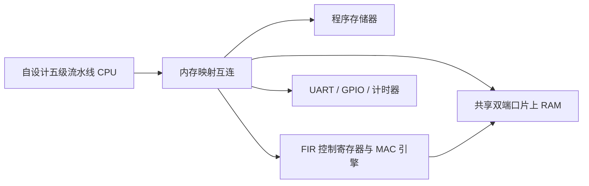

# RISC-V CPU + FIR 加速器：项目规格草案

日期：2026-10-28。状态：CPU 实现 37 种 RV32I 指令加 MUL，共 38 种；C 软件 FIR 与 MMIO 驱动的专用 FIR 硬件均已通过功能仿真。第十四步统一编译、数据布局与完整调用计时边界，在同一 RTL 上完成七组数据、三种模式、两种等待策略的 42 个测量。基准八样本为软件 2044 拍、含系数装载的硬件冷调用 919 拍、系数驻留调用 392 拍，周期比分别为 2.224×、5.214×；驻留预配置不在主区间内。指令 ROM 和共享数据 RAM 仍各 1 KiB，固件代码不超过 512 字节。第十五步增加自动启动与 LED 自检顶层，参考器件 EP4CE115F29C7 在 Quartus Lite 17.0 上完成综合、布局布线和 25 MHz 时序检查，占用 26,980 LE，最差 setup/hold 余量 +7.131/+0.180 ns。用户已反馈第一版下载后的 LED 自检及 KEY0 复位符合预期；JP7=2.5 V、JP6=3.3 V 已从照片核对，完整芯片丝印仍待读清。第十六步新增数码管输出选择和程序周期显示，四次启动/复位仿真通过；27,451 LE 的参考实现已通过 25 MHz 时序，新增显示已获用户反馈可用，逐项视频观察记录待补。当前接口见 [fir-mmio-1k-v1](fir-mmio-contract.md)，计时条件见 [周期对照契约](fir-benchmark-contract.md)，参考实现证据见 [第十五步](step15-quartus-guide.md)。长块对照、完整 M 扩展/执行环境、流水线及板级结果仍待实现与验证。

当前实现细节见 [CPU 契约](tiny-cpu-contract.md)。仅对实际转移的分支/跳转目标执行固定 ROM 范围检查；无效目标进入教学用 FAULT，不等价于标准指令访问异常与 trap handler。下文的流水线、更大存储和完整地址布局描述系统目标，不代表当前已实现。

## 1. 项目问题与贡献边界

研究问题：在同一块 DE2-115、同一 CPU、同一输入数据和同一定点数值语义下，将 FIR 内层乘加与数据复用交给专用硬件，可以获得怎样的完整处理时间改善？硬件并行度增加后，面积、存储带宽、时序和实际收益如何变化？

项目贡献定位为自行实现的 CPU、协处理接口、FIR 硬件和可复现评价流程。五级流水线、RISC-V 指令集和 FIR 算法均为已有技术；任何创新或性能优势需要实验支持。

主要比较对象为同一自设计 CPU 上经过合理优化的定点 C FIR。外部 CPU/FPGA IP 若被采用作参照，须单独标明配置和来源。

## 2. 系统结构

CPU 运行裸机 C 程序，配置 FIR 源地址、目标地址和样本数量，启动加速器，等待完成并检查结果。初版使用轮询；中断和实时音频作为后续扩展。

第一版数据存放在片上 RAM。初始实现按块处理；输入、输出和历史状态的边界明确后再扩展连续流。

## 3. CPU 目标

- 32 位、单发射、顺序执行的五级流水线：IF/ID/EX/MEM/WB。
- 模块包括 PC、寄存器组、译码、立即数生成、ALU、访存和写回。
- 实现 EX/MEM、MEM/WB 数据旁路，load-use 暂停、控制转移清空和存储器等待。
- 第一阶段分批实现 RV32I 指令；最终 RV32I 范围、异常行为和执行环境必须逐条文档化。
- 后续加入 M 扩展的乘除及余数指令；完整实现并验证前不标称完整 RV32IM 支持。
- CSR、中断、FENCE/系统指令和非对齐访问策略需单独列明；功能状态不能由程序运行成功推断。
- 预留指令提交记录，至少包含提交 PC、指令、寄存器写回及访存效果，用于差分验证。
- 仿真可使用外部监视器计数；板上计时使用内存映射计数器，避免在 CSR 尚未实现时假定 `mcycle` 可用。
- 主频目标在完整料号、时钟约束及基线综合后确定。

CPU 软件与硬件加速比较使用同一个 CPU 版本、相同乘法能力及相同存储器配置。

## 4. FIR 数值契约

第一步冻结为 `fir-q15-block-v1`，精确语义、文件格式及示例见 [数值契约](numeric-contract.md)。本节的接口及计算结构仍为后续 RTL 提案。

### 基础配置

- 抽头数：32，未来可参数化。
- 输入与系数：16 位二进制补码，15 个小数位，值等于整数除以 32768。
- 原始乘积：有符号 32 位、30 个小数位。
- 累加器：有符号 40 位、30 个小数位；32 抽头和规定输入范围下可容纳最坏情况。
- 输出：16 位二进制补码，15 个小数位。
- 系数运行时可写，任务执行期间锁定。
- 独立块处理，每次启动清零历史，块首之前的输入视为 0，产生与输入等长的输出。

整数计算定义：

`A[n] = sum(H[k] * X[n-k], k=0..31)`，其中 `X[j]=0`（`j<0`）。

先按绝对值将 `A` 舍入至最近的 `A/2^15` 整数，恰好半格时远离零；再恢复符号，最后饱和到 `[-32768,32767]`。软件参考必须显式实现负数舍入，不能依赖右移负数的实现差异。

输出测试分为两层：硬件与 Python 整数模型逐样本完全相等；量化结果与浮点 FIR 的误差另作算法分析。

### 计算结构

- 基线硬件采用一个 MAC 通路，多周期完成一个输出。
- 样本窗口与系数保存在本地寄存器/缓冲中，复用相邻输出所需的数据。
- 从共享 RAM 读入新样本，将输出写回 RAM；测量包括这些读写和等待。
- 扩展版本考虑 2/4 路 MAC。需要同步修改本地缓冲读端口/分组及归约累加器，核实数据供给能力。
- 不能以乘法器数量推断吞吐或实时能力。

## 5. 存储与控制接口提案

第十三步已实现的原型为独立 1 KiB ROM、0～1023 的共享数据 RAM 及 0x40003000 的 FIR 页；寄存器偏移、字对齐和错误码以 [当前接口](fir-mmio-contract.md)为准。下面的 32 KiB 和 0x00010000 RAM 基址仍为后续扩容提案。

程序存储器和共享数据 RAM 各暂定 32 KiB，最终以资源及软件需求调整。

提议地址布局，当前不是引脚或已实现接口：

| 区域 | 基址 | 大小/用途 |
| --- | --- | --- |
| 程序存储器 | `0x00000000` | 32 KiB |
| 共享数据 RAM | `0x00010000` | 32 KiB |
| UART | `0x40000000` | 预留 4 KiB |
| GPIO/显示 | `0x40001000` | 预留 4 KiB |
| 计时器 | `0x40002000` | 预留 4 KiB |
| FIR | `0x40003000` | 预留 4 KiB |

FIR 寄存器应包含 `CONTROL`、`STATUS`、`SRC_ADDR`、`DST_ADDR`、`SAMPLE_COUNT`、周期计数和系数窗口。

- 初版每个样本占一个 32 位内存字，低 16 位为样本，上 16 位为符号扩展；地址按 4 字节对齐。
- CPU 使用 RAM A 端口，加速器使用 B 端口；读取延迟按真实同步存储器建模。
- 内部请求/响应必须规定接受时刻、等待时稳定性和一次请求对应一次响应。
- CPU 在 BUSY 期间不得修改输入、系数、配置或访问输出缓冲；软件驱动与测试共同约束。
- 输入/输出缓冲必须位于共享 RAM、互不重叠并完整容纳任务；越界或非对齐任务在开始前拒绝。
- BUSY 期间再次 START 拒绝并报告错误；不得重启或重复执行正在进行的任务。
- 完成状态只在最后一个输出写入成功后置位；复位取消任务并清除 BUSY。
- 执行中复位可能留下部分输出；软件须把整个输出缓冲视为无效并重新启动任务。
- 精确寄存器偏移、错误码、状态清除及复位时序在 RTL 前冻结。

## 6. 验证计划

### CPU

- 模块自检查：算术、立即数、寄存器零号、读写及复位。
- 指令定向测试，覆盖符号比较、移位、分支、访存宽度及乘除边界。
- 流水线相关、暂停叠加、跳转清空、访存等待和复位中的任务取消。
- 与独立 ISA 参考逐条比较提交结果；可采用 Python 原型并用 Spike 交叉检查。
- 对选定 ISA/执行环境适配架构测试。架构测试是验证的一部分，不能代替全部处理器验证。
- 可选引入 RVFI/形式验证；工具链和 HDL 支持确认后再纳入必做范围。

### FIR 与系统

- 零输入、单位脉冲、阶跃、正负极值、交替极值和固定种子随机输入。
- 正负半格舍入、正负饱和、系数更换、短块、零样本任务、长块和连续任务。
- 注入存储器等待、错误配置、重复 START 和执行中复位。
- 软件 FIR、参考模型和硬件 FIR 逐样本比对。
- 对检查器进行受控故障注入，确认错误会导致非零退出；故障版本不进入交付物。

## 7. 性能与资源实验

当前已完成的对照固定 N=8，采用相同 CPU/MUL 能力、公共 signed32 RAM 布局和完整调用标记；软件保留跳过初始零历史的优化，不写额外累加器调试数组。全部七组冷调用周期比为 2.185～2.332×，系数驻留调用为 5.122～5.467×。内部 CYCLES 与完整调用周期分开，驻留模式也保留区间外的系数装载证据。这些是模拟时钟周期关系；第十五步的资源/时序记录属于 C 自检参考顶层，并非软件与硬件两种配置的面积成组对照。下面的大块、成组资源和板级实验仍为后续计划。

主要测试：32 抽头，块长 64/256/1024；输入、系数、舍入、饱和及初始历史保持一致。

比较配置：

- S：同一 CPU 运行定点 C FIR，使用合理优化、可审计的实现。
- H1：同一 CPU 调用单路 MAC FIR。
- H2/H4：同一 CPU 调用 2/4 路 MAC FIR，作为后续受控实验。

固定编译器版本、`-march/-mabi`、优化级别、工具版本、时钟和存储配置；记录实际命令。

记录：

- 结果是否逐样本相等，最大浮点参考误差及相关误差统计。
- CPU 软件周期数、硬件内核周期数、含配置/等待/必要搬运的完整调用周期数。
- 单次任务完整耗时、吞吐、CPU 占用和加速比。
- LE、寄存器、M9K 和实际乘法器资源。
- 完整约束下布局布线后的 setup/hold 结果及可支持时钟配置。
- 不同并行度的增量面积和完整耗时变化。

`加速比 = 软件完整处理时间 / 硬件完整调用时间`。

分别报告“系数已驻留”和“包含首次系数装载”的场景；明确计时边界和重复次数。任何搬运或预处理省略必须在实验说明中给出。

不预先设定已达到的加速倍数、主频或实时性结论。

## 8. 实施里程碑与发布证据

1. 冻结数值契约、建立独立 Python 定点模型与边界测试。
2. 完成 CPU 指令与流水线验证，运行 C FIR 软件基线。
3. 完成 H1 加速器、寄存器接口、共享 RAM 和 C 驱动，获得一致结果。
4. 在 DE2-115 完成约束、综合、布局布线、时序检查、下载和真实结果观察。
5. 扩展 H2/H4，形成面积/时序/完整处理时间的成组对比。
6. 选择性增加连续流状态、音频 Codec 接口、缓冲和长期吞吐验证。

每次发布保留源码版本、完整器件号、引脚与时钟来源、工具版本、参数、测试命令/日志、资源/时序报告、生成物哈希和硬件观察。GitHub CI 首先覆盖无需开发板的模型与 RTL 回归；Quartus 与板级证据单独归档并标记运行条件。

## 9. 开始 RTL 前待定项

- 当前基础 CPU 模块使用 VHDL-93；后续模块沿用同一接口与工具约定。
- FPGA 完整料号、板卡修订、官方原理图和引脚文件。
- CPU 复位入口、存储握手、非法指令/访问异常及系统指令范围。
- FIR 精确寄存器定义、复位及访问规则。
- C 交叉编译器与可移植 RTL 回归环境。
- 代码许可证；引用、复用与自编代码的来源记录方式。

以上待定项不改变本提案的软硬件协同主线；依赖项核实后再形成可下载的板级工程。
