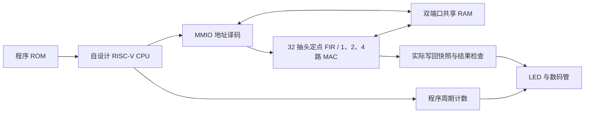
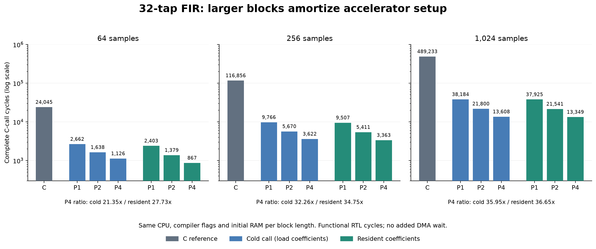
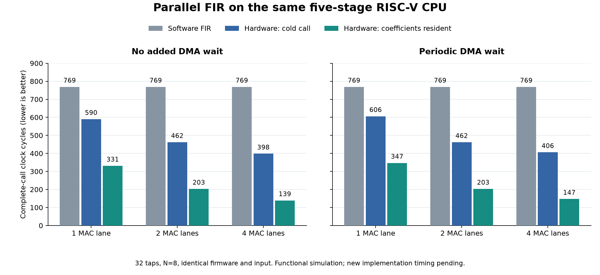

> 本页保留 step22 整理前的开发记录，数字和待办按当时阶段解读。当前入口见[项目首页](../README.md)。

# RISC-V FIR SoC

基于 **Terasic DE2-115** 的自设计 RISC-V CPU 与 32 抽头定点 FIR 加速器。CPU 运行裸机 C，通过 MMIO 配置 FIR；硬件读取共享 RAM、完成滤波并写回，软件与板级监测器检查结果，数码管显示实际输出和程序周期。

CPU 实现 **37 种 RV32I 指令 + MUL**，同时保留多周期与五级流水线版本。[第十八步流水线 SoC](../docs/step18-pipeline-soc-guide.md)已完成用户编译与上板反馈。第十九步新增[1/2/4 路 FIR 的匹配比较](../docs/step19-parallel-fir-guide.md)：四路 p4 已通过 25 MHz 时序，用户反馈板上符合预期；同版 p1/p2/p4 已全部通过编译与 25 MHz 时序核对。完整 M 扩展仍属后续目标，当前版本不标称完整 RV32IM。

**已上板 step20：** [32 KiB M9K 与 64/256/1024 点长块 FIR](../docs/step20-large-block-guide.md)已完成 45 组实际 C 执行、全 RAM/ISA/DMA 审计及整板功能仿真。1024 点软件/四路冷调用为 489233/13608 拍。首次编译的 10481 组件绑定问题已修订。用户完成 r1 编译后，实际为 7464 LE、48 块 M9K，25 MHz setup/hold +9.726/+0.152 ns；SOF 身份已审阅，用户已概括确认上板行为符合预期；记录见 reports/step20-large-block/board-observation.json。

**下一项 step21：** [同一镜像的九组板上计时](../docs/step21-board-benchmark-guide.md)已完成四次整套仿真与独立秒表核对，自动运行三种长度的软/硬件模式。用户编译报告已审阅：14,171 LE、32 M9K，25 MHz setup/hold +10.184/+0.181 ns；已准备核对后的 SOF，等待下载和实际读数。step20 r1 用户已反馈行为符合预期。

## 从这里开始

| 你要做的事 | 文档 |
| --- | --- |
| 生成工程、编译、下载、使用开关 | [运行指南](../docs/quickstart.md) |
| 录实物演示视频 | [拍摄顺序与解说](../docs/demo-recording.md) |
| 理解 CPU、RAM、FIR、显示之间的连接 | [系统结构](../docs/architecture.md) |
| 查看测试、资源、时序和计时边界 | [验证记录](../docs/verification.md) |
| 整理视频并准备 GitHub 发布 | [发布准备](../docs/github-publishing.md) |
| 回看 ALU 到系统集成的开发顺序 | [分阶段开发记录](../docs/development-history.md) |
| 验证独立五级流水线 CPU、查看暂停和旁路 | [第十七步指南](../docs/step17-pipeline-guide.md) |
| 编译五级 CPU + FIR 的新板级版本 | [第十八步指南](../docs/step18-pipeline-soc-guide.md) |
| 比较 1/2/4 路 FIR、查看三组实现 | [第十九步指南](../docs/step19-parallel-fir-guide.md) |
| 编译 32 KiB 存储与 1024 点四路候选 | [第二十步指南](../docs/step20-large-block-guide.md) |
| 一次下载，查看九组实际完整调用计数 | [第二十一步指南](../docs/step21-board-benchmark-guide.md) |

**当前实物状态：** 多周期、step18 单路五级与 step19 四路 p4 均已有用户板上结果符合预期的反馈。四路实现报告与反馈见[编译记录](../reports/step19-parallel-fir/quartus-p4-validation.json)及[观察记录](../reports/step19-parallel-fir/board-p4-observation.json)。尚未收到独立逐项读数、Programmer 日志或演示视频。

## 系统结构



## 已实现的内容

- 自行编写的 CPU 数据通路、寄存器组、译码/立即数、控制、字节/半字/字访存和 MUL。
- signed16 Q15 输入/系数、signed40 累加、最近舍入且半格远离零、signed16 饱和的串行 FIR 核。
- 运行时系数配置、MMIO 状态与错误码、双端口共享 RAM、裸机 C 驱动和有限轮询超时。
- 同步程序 ROM、完整 RAM 初值装载、KEY0 重启、实际 DMA 写回检查及输出快照。
- Python 定点参考、独立向量审计、CPU/系统轨迹检查、RTL 故障注入和固定条件下的周期比较。

## 快速运行已上板的单路流水线版本

Python 3.10+，在仓库根目录执行；生成目录使用英文路径：

```powershell
python -m tools.prepare_de2_pipeline --output C:/fpga/riscv_fir_pipeline
```

随后由使用者在 Quartus 打开生成目录中的 `riscv_fir_de2_pipeline.qpf`，选择 **Processing → Start Compilation**。编译生成的 `output_files/riscv_fir_de2_pipeline.sof` 通过 USB-Blaster / JTAG 下载。生成脚本本身不编译或编程硬件；三种路数的独立工程见[第十九步指南](../docs/step19-parallel-fir-guide.md)。

参考编译目标为 **EP4CE115F29C7**，输入 50 MHz、实际二分频系统时钟 25 MHz。引脚按 DE2-115 官方手册及参考 JP7=2.5 V、JP6=3.3 V 配置；实际器件及电压应匹配工程，详见[运行指南](../docs/quickstart.md)。

| 操作 | 预期数码管内容 | 说明 |
| --- | --- | --- |
| SW3=0，SW2..SW0=000 | 00002000 | 第 0 个输出：8192 |
| SW3=0，SW2..SW0=001 | 00003000 | 第 1 个输出：12288 |
| SW3=0，SW2..SW0=010 | FFFFA800 | 第 2 个输出：-22528，补码显示 |
| SW3=1 | 000002B6 | 单路 FIR + 五级 CPU 整段自检 694 拍；多周期历史版为 0000046B |
| 按住 / 松开 KEY0 | 空白 / 重跑后恢复显示 | 同时重新装载初始数据 |

正常 LED 状态为 LEDR0/1 亮、LEDR2 灭、LEDR3 闪。完整八个输出见[对照表](../docs/quickstart.md#5-操作与预期显示)。演示视频收到后在这里加入真实媒体链接。

## 验证与参考实现

| 层次 | 已有证据 |
| --- | --- |
| 当前模型/工具 | [242 项 Python 测试、向量审计与重现检查](../reports/step20-large-block/python/validation.json) |
| CPU RTL | [188 个程序与受控故障检查](../reports/step11-software-fir/validation.json) |
| FIR 核与协同系统 | [核验证](../reports/step12-fir-accelerator/validation.json)、[系统验证](../reports/step13-fir-soc/validation.json) |
| 数码管版本 | [四次启动/复位、32 项输出选择、六项错误注入](../reports/step16-display/simulation-validation.json) |
| Quartus | [实现报告与 SOF 哈希](../reports/step16-display/quartus-validation.json) |
| 实物 | 用户反馈已收到；逐项视频与板上性能测量待补 |

历史多周期数码管版占 **27,451 LE**，25 MHz 最差 setup/hold slack 为 **+7.710 / +0.180 ns**。用户编译的 step18 五级流水线版占 **28,122 LE、11,967 寄存器、1,792 存储位、8 个 9 位乘法器元素**；最差 setup/hold 为 **+11.572 / +0.145 ns**，未约束摘要均为零、0 条关键警告、27 条普通警告，见[原始实现证据](../reports/step18-pipeline-soc/quartus-validation.json)。这些实现结果绑定归档的 step18 源码与 SOF，不能转用到新增并行配置。

核心 Python 检查只需要标准库，可独立运行：

```powershell
python -m tools.run_step1 --report-dir build/local-check
```

[GitHub Actions 工作流](../.github/workflows/reference-model.yml)已配置 Python 3.10/3.12 检查。已发布 v0.1 的成功记录见[运行 40790245986](https://github.com/yzm3341821990-boop/riscv-fir-soc/actions/runs/40790245986)；本地 step19/20 尚未上传，不能沿用该远端 CI 结果。

## 长块实验（step20，候选）

相同五级 CPU、32 KiB RAM、Zig 0.13.0 / Clang 18.1.6、`-O1`；以下为无额外 DMA 等待的完整 C 调用周期。每个长度使用相同初始 RAM，C 与独立轨迹检查器均核对全部输出。

| 样本数 | C 软件 | 四路冷调用 | 四路系数驻留 | 软件 / 四路冷调用 |
| --- | ---: | ---: | ---: | ---: |
| 64 | 24045 | 1126 | 867 | 21.35× |
| 256 | 116856 | 3622 | 3363 | 32.26× |
| 1024 | 489233 | 13608 | 13349 | 35.95× |

全部 1/2/4 路及等待条件共 45 次实际功能仿真，2080791 条提交逐条回放；新整板自检为 24917 拍（`00006155`）。这些是功能仿真周期关系。r1 已通过用户实际 Quartus 编译与 25 MHz 时序；尚无该候选的板上成对性能结论。见[第二十步指南](../docs/step20-large-block-guide.md)。



## 软件 / 硬件周期对照（step19 与历史版本）

当前五级 CPU、N=8、32 抽头、无额外 DMA 等待的完整调用结果如下。软件基线固定为 769 拍；固件、输入、CPU 与内存布局均由哈希配对检查。

| MAC 路数 | 硬件冷调用 | 系数驻留调用 | 软件 / 驻留调用 |
| --- | ---: | ---: | ---: |
| 1 | 590 | 331 | 2.323× |
| 2 | 462 | 203 | 3.788× |
| 4 | 398 | 139 | 5.532× |

这些是功能仿真的完整调用周期，包含相应驱动开销，尚非新配置的板上性能测量。七组输入、三种模式、两种等待条件及三种并行度的 126 次执行见[逐次数据](../reports/step19-parallel-fir/measurements.csv)与[比较表](../reports/step19-parallel-fir/comparison.csv)。



下面保留多周期历史结果：

以下来自同一 CPU、相同编译器/MUL 能力、相同数据布局和完整调用标记下的 **N=8 功能仿真**：

| 模式 | 完整调用周期 | 软件周期 / 该模式 |
| --- | ---: | ---: |
| 软件 FIR | 2044 | 1.000× |
| 硬件冷调用，含系数配置 | 919 | 2.224× |
| 硬件调用，系数预先驻留 | 392 | 5.214× |

驻留模式的预装成本在区间外另行记录。以上数据与数码管的 1131 拍自检程序属于不同固件/区间，不能直接混算；板上实测加速比尚未取得。完整条件见[计时契约](../docs/fir-benchmark-contract.md)和[逐次 CSV](../reports/step14-fir-benchmark/comparison.csv)。


## 仓库结构

| 目录 | 内容 |
| --- | --- |
| model/、vectors/ | 无第三方依赖的参考模型、数值向量与清单 |
| rtl/cpu/、rtl/fir/、rtl/soc/ | CPU、FIR、MMIO 和共享 RAM |
| rtl/board/、fpga/ | 板级启动、结果显示、引脚与时钟约束 |
| firmware/、programs/ | C/汇编/链接脚本，以及已编译固件与编译清单 |
| sim/、tests/、tools/ | Testbench、Python 检查与工程生成/收集工具 |
| docs/ | 当前指南、设计契约、开发记录和发布材料 |
| reports/ | 各阶段原始日志、测量与哈希记录 |
| artifacts/ | 数值/周期图表及待整理的演示媒体 |

## 当前边界与后续方向

多周期、单路五级及四路 FIR SoC 均已获用户实物反馈。四路 p4 实际占 28,130 LE、14 个 9 位乘法器元素，25 MHz setup/hold 最差余量 +11.166/+0.119 ns；0 关键警告，未约束摘要各项为零。同版 p1/p2/p4 的资源和时序对照已完成。没有完整 M 扩展、CSR/标准异常处理、Cache 或实时音频链。step18/19 的共享 RAM 推导为寄存器与选择逻辑。step20 新增的 32 KiB RAM 已实际映射到 32 块 M9K，r1 总占用 7464 LE、48 块 M9K，25 MHz 时序通过；已有用户上板符合预期反馈；独立视频及成对基准读数另行记录。

实物视频和逐项观察记录由用户录制；同版 1/2/4 路资源扫描已完成，本地 step20 长块候选也已交付。程序 ROM 扩容、预留外设及完整执行环境仍为目标设计，范围见[项目规格](../docs/project-spec.md)。

## 来源与许可证

实现、规范与工具依赖的边界见 [THIRD_PARTY.md](../THIRD_PARTY.md)。当前没有 LICENSE 文件，项目许可证尚未选定；发布准备项见[说明](../docs/github-publishing.md)。
