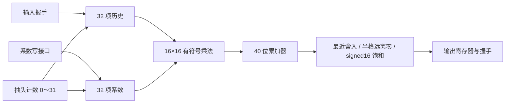

# 第十二步：独立串行 MAC FIR 硬件核

本页保留独立运算核的学习入口；最新的 CPU/MMIO/共享 RAM 集成见[第十三步](step13-cpu-fir-soc-guide.md)。

上一阶段由 CPU 逐条执行 C 程序完成滤波。本阶段增加自行编写的专用 FIR RTL：样本进入历史寄存器后，同一个 16×16 有符号乘法表达式按抽头顺序重复使用，40 位累加，最后统一舍入和饱和。数值规则沿用第一步。CPU 软件路径和独立硬件核目前分别验证；CPU 的控制寄存器、共享 RAM 包装器和 C 驱动在下一阶段连接。

## 在 ModelSim 运行

在底部 Transcript 输入下面这一条命令。脚本会卸载已加载的设计，再切换目录和编译，不需要先手动关闭旧 CPU 仿真。

```tcl
do {F:/CodexWorkspace/outputs/riscv-fir-soc/fir_accel/baseline/run_fir_accel_gui.do}
```

演示使用与 C 版相同的八个输入和 32 个系数。Transcript 应自动出现 `FIR_SERIAL_PASS samples=8 stalls=12 protocol_outputs=0`，以及 `FIR_ACCEL_GUI_READY`。这些是程序输出，不要当成命令输入。

默认波形包含初始化和全部八个样本，游标位于仿真结束处，约 3606 ns。末尾 35 拍用于确认没有多余输出，整个演示时间还包含系数配置和故意加入的等待，因此不能拿它与 C 仿真总时间直接相除。

| 信号 | 观察方法 |
| --- | --- |
| cfg_valid、cfg_ready、cfg_addr、cfg_data | 两个握手位同为 1 的上升沿写入一个系数，共 32 项 |
| clear_valid、clear_ready | 配置后握手清零历史，系数保留 |
| s_valid、s_ready、s_data | 两者同为 1 的上升沿接受输入 |
| state | 接受样本后依次为 MAC、HOLD_OUTPUT、IDLE |
| tap_index | 32 次 MAC 使用 0～31；最后一项不能遗漏 |
| running_acc | 每拍把一个完整 signed32 乘积符号扩展至 signed40 再累加 |
| m_valid、m_ready | 结果出现后 valid 保持 1，直到 ready=1 的边沿接收 |
| m_data、m_acc | 当前结果及其舍入前的完整累加值；暂停期间两者保持稳定 |
| checked_samples | 实际检查完成的样本数，最终为 8 |
| y0～y7 | testbench 在输出握手时捕获的实际 DUT 数据，方便同时查看八个结果 |
| finished | 最终为 TRUE |

把第一个输入握手附近放大：输入在 355 ns 边沿接受；365～675 ns 完成 32 次乘加；675 ns 边沿之后 m_valid=1，最早在 685 ns 边沿接收。无等待时下一输入最早在 695 ns 接受，间隔 34 拍。演示对后续输出故意增加 0～3 拍等待，并穿插输入间隙，可观察结果稳定性。

八个输出应为 **8192、12288、−22528、17408、−12288、15360、−7680、−2048**，与 C 版一致。它们是 Q15 原始整数，除以 32768 才是归一化幅值。原始累加值依次为 268435456、402636800、−738189312、570421248、−402655232、503316480、−251658240、−67108864。

## 结构与接口



[接口契约](fir-accelerator-contract.md)冻结接受边沿、优先级、延迟、暂停、复位和块边界。空闲时 clear > 系数配置 > 输入；忙时三个 ready 都为 0。每个样本固定做 32 次 MAC，包括零系数和初始零历史，尚未采用乘加流水线或零项跳过。

连续输入保留 31 个旧样本。新独立块必须在空闲时执行 clear；clear 不改系数。同步复位取消当前运算或待接收输出，同时清零历史和系数。输出数量与输入数量相等，不产生卷积尾部。空块执行 clear 后没有样本事务，产生零个结果。

32 项系数和历史在当前 RTL 中是有复位的寄存器数组描述。没有声称推断出某种 RAM 或单个物理 DSP；资源、时序和器件映射须查看未来 Quartus 报告。

## 验证与复现

```sh
python -m tools.run_fir_accel --modelsim-bin E:/quartus/modelsim_ase/win32aloem --build-dir F:/CodexWorkspace/outputs/riscv-fir-soc/fir_accel
python -m tools.check_fir_accel_switch
python -m tools.run_step1
```

24 组 ModelSim 用例检查 1855 个正常样本、44 个协议专项输出和 2772 拍输出等待。每个正常样本逐点检查 signed16 结果、signed40 原始累加值及精确 32 拍运算延迟。原 13 组、1711 样本的向量保持逐字节不变，由独立的 Fraction 散布卷积检查器审计；新增七组已编译 C 固件输入、H[31] 单独非零、非半格舍入边界、协议专项及无额外间隙运行。

协议专项检查忙时不接受配置/清历史/输入、输出等待稳定、合法请求保持到 ready 后只接受一次、clear 保留系数、配置保留历史和控制优先级。运算第一拍、中间拍、最后一拍以及结果等待状态下复位必须取消在途事务；另将全部系数写成非零后复位，用连续 32 个输入确认全部系数清零。

12 个 RTL 故障版本分别改变舍入、负数移位、正饱和、累加器位宽、乘积符号扩展、最后抽头、系数顺序、输出等待、清历史、运算中复位、系数复位和忙时系数保护。每项都必须由运行中的断言发现，并使模拟器非零退出；编译失败不计作测试有效。故障版本仅存在于临时构建目录。

这次故障注入还发现了测试边界需要细分：负数恰好半格时，算术右移也会碰巧等于“半格远离零”。新增的 -1/32768、半格以下与半格以上用例能拒绝这种错误实现。

全部 178 项 Python 测试通过。CPU 软件 FIR 与新硬件宏在同一个 ModelSim 进程中完成四次加载、三次设计切换，两次直接读回新核捕获的八个有符号输出。该切换检查在命令行运行，不构成 GUI 像素布局检查。

- [RTL](../rtl/fir/fir_serial.vhd)
- [自检查 testbench](../sim/tb/tb_fir_serial.vhd)
- [验证报告](../reports/step12-fir-accelerator/validation.json)与[正常仿真日志](../reports/step12-fir-accelerator/modelsim.log)
- [加载切换及实际输出读回](../reports/step12-fir-accelerator/gui-switch.json)

当前只证明独立运算核的功能行为。下一步加入 MMIO 控制、同步共享 RAM 访问、任务完成条件及 C 驱动，再以包含全部调用开销的时间进行软硬件比较；综合、布局布线、静态时序、下载和板级观测尚未执行。
