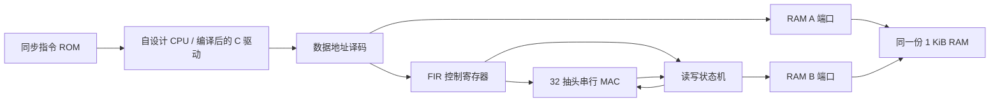

# 第十三步：C 程序驱动自设计 CPU 与 FIR 加速器

本页保留系统接线与 C 驱动的学习入口；统一条件下的软件 / 硬件周期对照见[第十四步](step14-fir-benchmark-guide.md)。

本步把 CPU、FIR 寄存器、串行 MAC 核和双端口同步 RAM 接成一个功能系统。Clang 编译的 C 程序实际写入 32 个系数与缓冲区地址，启动任务、轮询完成状态，再读取硬件写回的结果并逐项比较。结果来自 RAM B 端口的真实写入，不由 testbench 代填。

## 一条命令运行

在 ModelSim 底部 Transcript 输入：

```tcl
do {F:/CodexWorkspace/outputs/riscv-fir-soc/soc/baseline/run_soc_gui.do}
```

脚本先卸载旧设计，再切换目录、编译、添加波形并运行完。应自动出现 `FIR_SOC_CPU_PASS`，最后出现 `FIR_SOC_GUI_READY C_done=1 C_errors=0 HW_written=8.`。这是运行输出，不要再次输入。

| 波形 | 正常结束的值或观察方法 |
| --- | --- |
| PC、commit_valid、retired_count | CPU 实际执行驱动；结束 PC=0x12C，提交 356 次 |
| cpu_req、cpu_we、cpu_addr、cpu_wdata | 观察对 0x40003000 寄存器页的配置、START 和轮询 |
| FIR_STATUS | 0=空闲，1=忙，2=完成；本例最终为 2 |
| HW_written | 只有实际 RAM 写入被接受才增加，最终为 8 |
| HW_cycles | 本例为 309，包括内部清历史、读、MAC、写及注入的 RAM 等待 |
| dma_req、dma_ready、dma_we、dma_addr | 每样本一次读、一次写，共 8 读 8 写；ready=0 时请求保持 |
| y0～y7 | 直接查看共享 RAM 中八个 signed32 符号扩展的 Q15 输出 |
| C_done、C_errors、C_polls | 最终分别为 1、0、13 |
| finished | 最终为 TRUE |

八个输出仍为 **8192、12288、−22528、17408、−12288、15360、−7680、−2048**。这是相同输入与数值语义下的正确性对照。一个输出占一个 32 位 RAM 字，数值是 signed16 的符号扩展，除以 32768 才是归一化幅值。

可以沿时间轴分三段观察：先看到 CPU 把系数写入 0x40003100～0x4000317C；随后把源地址、目的地址和长度写入寄存器并 START；最后在 CPU 轮询 STATUS 的同时，FIR 通过 RAM 的另一端口读样本、执行 MAC、写输出。只有最后一次写入被接受后 STATUS 才变成 2，CPU 才读取八个输出。

## 接线与存储布局



CPU 默认实例仍只接受原有 RAM 地址；新 SoC 使用 `ENABLE_FIR_MMIO=true`，额外允许 0x40003000～0x40003FFF 页中的对齐 LW/SW。该页的字节/半字、非对齐访问和其他高地址仍进入教学用 FAULT。未定义寄存器在外设内返回 0 并记录错误。标准异常处理、缓存、总线仲裁和中断仍未实现。

精确接口见 [fir-mmio-1k-v1](fir-mmio-contract.md)。每个任务最多 128 个样本；两个缓冲区必须在 1 KiB RAM 中且不重叠。软件在 BUSY 期间只轮询寄存器、使用不相交的其他 RAM，不访问任务缓冲区。每次 START 在核内清历史，保留已经配置的系数；复位取消任务、清系数与配置，保留 RAM。

当前 C 固件使用下面的实际 ELF 布局：

| 对象 | 字节地址 | 内容 |
| --- | --- | --- |
| 代码 | 0～299 | 75 条静态 RV32I 指令，无 M 指令依赖 |
| samples | 512 / 0x200 | 8×signed32，Q15 符号扩展输入 |
| coefficients | 544 / 0x220 | 32×signed32，Q15 符号扩展系数 |
| expected | 672 / 0x2A0 | C 自检的八个参考值 |
| outputs | 704 / 0x2C0 | RAM B 端口写回的八个结果 |
| polls / errors / done | 736 / 740 / 744 | C 轮询计数、错误数和检查结束标志 |
| hw_cycles / hw_written | 748 / 752 | C 从外设读回的计数 |
| 栈顶 | 1024 / 0x400 | 启动代码设置 SP，程序结束仍为 1024 |

RAM 初值由 testbench 在复位期间通过 A 端口装载；这是仿真启动方式，不能当成已经完成的板上 ROM/Flash 启动流程。结束由 testbench 识别编译清单中的程序末尾并停钟，不是新增 HALT 指令。

## 检查了哪些行为

系统用同一份机器码运行七组数据：基准、冲激、半格舍入、正向极值、负向极值、零输入和零系数。另有不注入 DMA 等待的基准，以及下游永久不接受请求的超时测试，共 9 个系统用例，其中 8 个成功完成、1 个按预期返回错误。

正常基准提交 356 条指令，接受 142 笔 CPU 数据请求；FIR 单独接受 8 次 RAM 读和 8 次 RAM 写，硬件任务计数 309 拍。无注入等待时硬件任务计数为 297 拍，CPU 轮询次数随之变化。这些都是 10 ns 功能仿真时钟下的周期计数，不是可实现主频或板上实测性能。

超时用例最多轮询 64 次，C 返回 1、errors=1、done=1，不读取仍由硬件占用的输出。硬件在永久等待时仍 BUSY，所有输出保持初值；重新使用前须全局复位。该用例验证错误返回，不计作一次成功滤波。

完整轨迹检查独立维护 CPU 寄存器、RAM 和 MMIO 状态，重放 3544 次 CPU 提交、1459 笔 CPU 数据请求及 64 读/64 写的系统 DMA 事务。逐项核对指令、写回、下一 PC、CPU 访存地址/数据/字节使能、DMA 顺序与数值参考、硬件周期计数，以及每个用例最终的全部 256 个 RAM 字和 32 个寄存器。没有把 DUT 的 PC 当作期望 PC，也没有只检查 C 的 done 标志。

另外 20 个外设用例完成 40 个主要块任务、检查 1502 个输出，覆盖短块、128 样本、最高 RAM 字、连续独立任务、DMA 等待、系数就绪、错误编码、地址/范围/重叠拒绝、BUSY 写保护、最后写入完成语义和运算/读等待/写等待中的复位。11 个 CPU 专项用例验证 MMIO LW/SW、字节/半字拒绝、非对齐、错误页和默认关闭配置。

15 项故意引入的 RTL 错误均由运行中的断言或明确的 C/RAM 读回检查发现；编译失败不计作有效检测。检查器自身也用错误 DMA 输出、错误 MMIO 返回、错误下一 PC、损坏 RAM/寄存器等证据测试，避免只验证“程序看起来跑完”。

## 复现和证据

```sh
python -m tools.run_soc --modelsim-bin E:/quartus/modelsim_ase/win32aloem --build-dir F:/CodexWorkspace/outputs/riscv-fir-soc/soc
python -m tools.check_soc_switch
python -m tools.run_step1
```

重编译驱动使用 `python -m tools.build_accel_demo`，固定 Zig 0.13.0 / Clang 18.1.6、base RV32I 和 ILP32，沿用既有启动代码及链接布局。日常测试校验入库 ELF/镜像及其源码哈希，无须重新下载编译器。

本次全部 186 项 Python 测试通过；原有 188 个 CPU 程序与 26 项 CPU/初始化故障检查已在修改后的默认 CPU 上重新通过。两个独立目录构建出的 ELF、汇编、ROM 镜像、RAM 初值和清单五项产物逐字节一致，并与入库产物相同，见[编译复现记录](../reports/step13-fir-soc/compiler-reproducibility.json)。真实 GUI 宏在命令行完成五次加载、四次设计切换，并两次读回共享 RAM 的八个有符号输出；这项检查不检查 GUI 像素布局。

- [C 驱动源码](../firmware/c_fir_accel/main.c)、[实际汇编](../programs/c_fir_accel/main.s)、[编译清单](../programs/c_fir_accel/manifest.json)
- [系统接线](../rtl/soc/fir_soc.vhd)、[控制寄存器与 DMA 状态机](../rtl/fir/fir_mmio.vhd)、[共享 RAM](../rtl/soc/shared_ram.vhd)
- [系统验证报告](../reports/step13-fir-soc/validation.json)、[逐条重放结果](../reports/step13-fir-soc/trace-audits.json)、[ModelSim 日志](../reports/step13-fir-soc/modelsim.log)
- [真实 GUI 宏加载切换与有符号 RAM 读回](../reports/step13-fir-soc/gui-switch.json)

当前已证明 CPU 与专用 FIR 协作的功能流程。尚未执行 Quartus 综合、布局布线、静态时序、下载或板级验证，也尚未完成相同存储布局和完整调用边界下的公平软件/硬件基准，不能直接用本例 309 拍与上一软件 FIR 的周期相除来报告系统加速比。
