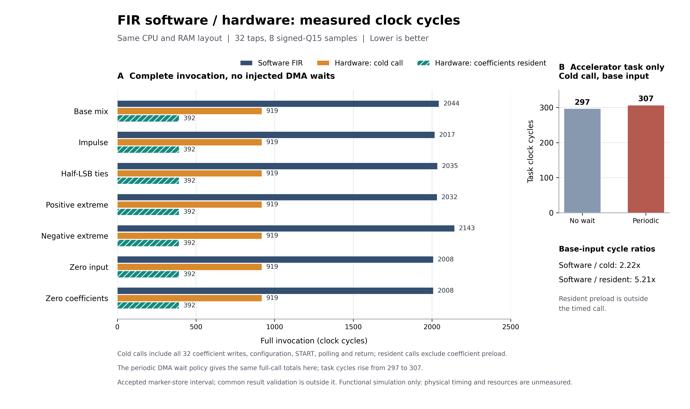

# 第十四步：软件 FIR 与硬件 FIR 的完整调用周期对照

这一阶段在同一套 CPU、FIR、同步 RAM 和 MMIO RTL 上，运行三份来自同一 C 源文件的固件。统一数据布局、编译条件和计时边界后，基准八样本任务的软件完整调用为 **2044 拍**，硬件冷调用为 **919 拍**，系数已驻留时为 **392 拍**。相应的功能仿真周期比分别为 **2.224×** 和 **5.214×**。

其中 2.224× 包含每次装载全部 32 个系数的成本，是本步主要对照。5.214× 的前提是系数已事先装入硬件，必须单独说明，不能当成冷调用结果。本步没有改变 RTL 或证明板上实际主频；这些数字表示相同平台上的模拟时钟周期关系。

## 在 ModelSim 中运行

在底部 Transcript 输入下面这一条命令：

```tcl
do {F:/CodexWorkspace/outputs/riscv-fir-soc/benchmark/baseline/run_benchmark_gui.do}
```

脚本先卸载旧设计，再编译并运行 `base_hardware_cold_none`，也就是基准数据、硬件冷调用、不额外注入 DMA 等待的用例。运行结束后出现 `FIR_BENCHMARK_GUI_READY`，并显示已经保存的完整对照摘要：software=2044、cold=919、resident=392，以及两个周期比。摘要来自完整回归报告；当前波形展示其中的冷调用用例。这些是自动输出，不要重新作为命令输入。

先看下面这些波形：

| 信号 | 看什么 |
| --- | --- |
| marker | 共享 RAM 中的计时标记，0 → 1 → 2；1～2 之间是完整调用区间 |
| accepted_clock_count | 仿真时钟的边沿计数；用两个已接受标记写入的计数相减 |
| PC、cpu_req、cpu_we、cpu_addr、cpu_wdata | CPU 实际执行 C 驱动，并写入系数、描述符和 START |
| FIR_STATUS | 1 表示忙，2 表示任务完成 |
| kernel_cycles | 仅加速器内部任务计数，本例为 297；不是完整调用的 919 拍 |
| written | 最终为 8；只有 RAM 写入被接受才增加 |
| dma_req、dma_ready、dma_we | 每个样本一次读、一次写，查看真实 RAM B 端口事务 |
| y0～y7 | 直接读取共享 RAM 中八个实际硬件输出 |
| done、errors、finished | 最终分别为 1、0、TRUE |

冷调用的开始标记在周期 290 被接受，结束标记在周期 1209 被接受，所以完整调用为 `1209 − 290 = 919` 拍。把 marker=1 附近放大，可以看到开始计时后仍有 32 次系数写入，而不是只统计 START 后的计算时间。

八个输出应为 **8192、12288、−22528、17408、−12288、15360、−7680、−2048**。它们是 signed16 的 32 位符号扩展 Q15 原始整数，除以 32768 才是归一化幅值。软件、冷调用、驻留调用均由独立检查器逐项核对这些数值。

## 为什么这次可以对照

上一阶段的软件固件使用紧密排列的 signed16 数据，还额外保存了八个 signed64 原始累加值；硬件固件使用一个样本占一个 32 位字的布局。两者的存储流量、调试写入和结束条件不同，不能拿旧仿真总时间直接相除。

本步重新建立了 [fir-benchmark-cycles-v1](fir-benchmark-contract.md) 对照契约：

- 同一 [C 源文件](../firmware/fir_benchmark/main.c)，只切换 software、hardware_cold、hardware_resident 三种编译模式。
- 同一 Zig 0.13.0 / Clang 18.1.6、O1、ILP32、`generic_rv32+m` 和其余参数；CPU 的 M 指令范围仍仅为 MUL。
- 同一 CPU/FIR/RAM RTL、同一时钟模型；每组数据的整个初始 RAM 镜像在三种模式间逐字节一致。
- 软件采用完整 signed32 乘积和 signed64 累加，最后按原契约舍入、饱和；不写额外的原始累加器调试数组。
- 每次调用均是独立的零历史块，产生八个输出，不附加卷积尾部。

输入和系数位于可变 RAM，七组运行时镜像运行同一份机器码，检查编译器没有把示例变成固定输出。它们不被强制声明为 volatile，允许编译器进行正常的数据复用。计时标记与状态字段是 volatile，边界使用编译器内存屏障。

软件允许用 `k <= n` 跳过块首尚不存在的历史样本。这是合法的优化：八样本块只需执行 1+2+…+8=36 次有效乘法。硬件串行核仍按每样本 32 次 MAC 运算；不能为了使硬件数字更好看，强迫软件多算已知为零的历史项。

共同布局固定在一个结构体中，地址由 ELF 清单和导出镜像核对：

| 字节地址 | 内容 |
| --- | --- |
| 512 / 0x200 | samples[8]，signed32 Q15 输入 |
| 544 / 0x220 | coefficients[32]，signed32 Q15 系数 |
| 672 / 0x2A0 | outputs[8]，signed32 Q15 输出 |
| 704 / 0x2C0 | marker，0 → 1 → 2 |
| 708 / 0x2C4 | done |
| 712 / 0x2C8 | errors |
| 716 / 0x2CC | polls |
| 720 / 0x2D0 | hw_cycles |
| 724 / 0x2D4 | hw_written |

结构体结束于 728，保留原有栈空间。三个固件代码可以不同，但数据字段地址和每组数据的初始 RAM 字节必须相同。

## 完整调用与内部计算怎样区分

计时来自真实 CPU 总线事务：普通 RAM 的 marker=1 写入被接受后开始，marker=2 写入被接受时结束。统一定义为 `call_cycles = end_edge − begin_edge`。起始标记接受边沿不计入，结束标记所在指令时间计入；全部模式采用相同边界与屏障策略。

| 模式 | 标记 1～2 之间计入的工作 | 基准无等待周期 |
| --- | --- | ---: |
| software | 函数调用、输入/系数读取、乘加、舍入、饱和、八个输出写入、返回及返回状态记录 | 2044 |
| hardware_cold | 函数调用、ACK、32 项系数装载、源/目的地址与长度、START、有限轮询、状态核对、返回及返回状态记录 | 919 |
| hardware_resident | 系数在标记 1 前装载；区间仍包括 ACK、描述符、START、轮询、状态核对、返回及返回状态记录 | 392 |

驻留模式的 32 次系数写入在区间外单独留有证据。当前每个固件执行一个任务，独立复位和装载 RAM；没有把它描述成已经测量过长期连续任务吞吐。

**392 拍不是一次从冷启动开始的整个硬件程序时间。** 逐次报告中的 `total_execution_edges` 显示，本例冷调用固件和驻留固件的完整 CPU 程序执行计数都为 **997 拍**，软件固件为 **2105 拍**；这些计数不包含 testbench 的 RAM 初值装载。冷调用标记从周期 290 开始，驻留调用标记从周期 817 开始，两者结束标记都是周期 1209。也就是说，驻留口径把 **527 拍的系数预配置工作移到了主区间之前**，没有让这项工作凭空消失。完整程序计数与标记区间是两个不同口径，报告分别保留，不能混用分子和分母。

硬件的 CYCLES 和 WRITTEN 诊断读取放在结束标记之后；数值检查也在计时后由独立检查器完成。两条路径均不在主区间里承担额外的 C 输出数组自检或累加器调试写入。

硬件内部 CYCLES 从 START 到最后一个输出写入被接受，基准无等待时为 **297 拍**。它包括内部清历史、DMA、MAC 和 RAM 等待，但没有包含 CPU 装载系数、配置参数、发现完成及返回的全部开销。因此完整冷调用周期比应为 `2044 / 919 = 2.224×`，不能用 `2044 / 297` 冒充完整调用结果。

## 七组数据的实测结果

下表均为无额外 DMA 等待，单位是模拟时钟拍。完整数据来自 [comparison.csv](../reports/step14-fir-benchmark/comparison.csv)，保留了所有七组结果。

| 数据组 | 软件调用 | 硬件冷调用 | 硬件系数驻留调用 | 软件/冷调用 | 软件/驻留调用 |
| --- | ---: | ---: | ---: | ---: | ---: |
| 基准 base | 2044 | 919 | 392 | 2.224× | 5.214× |
| 冲激 base_impulse | 2017 | 919 | 392 | 2.195× | 5.145× |
| 负向极值 base_negative_extreme | 2143 | 919 | 392 | 2.332× | 5.467× |
| 正向极值 base_positive_extreme | 2032 | 919 | 392 | 2.211× | 5.184× |
| 半格舍入 base_ties | 2035 | 919 | 392 | 2.214× | 5.191× |
| 零输入 base_zero | 2008 | 919 | 392 | 2.185× | 5.122× |
| 零系数 base_zero_coefficients | 2008 | 919 | 392 | 2.185× | 5.122× |



可导出的 [SVG](../artifacts/step14/fir-cycle-comparison.svg) 与[绘图来源记录](../artifacts/step14/plot-provenance.json)绑定实际 JSON 的 SHA-256；图中主面板呈现七组完整调用，右侧单独显示内部任务在等待条件下的变化。

软件调用的周期随量化分支等实际执行路径变化；不能只选择负向极值的最高周期比作为所有数据的结论。这里完整冷调用范围约为 **2.185～2.332×**，驻留系数调用范围约为 **5.122～5.467×**，且仅适用于本步固定的八样本工作负载和平台条件。

另有确定性等待测试：仿真时钟周期号 mod 7 为 0、1、2 时，RAM B 端口不接受 DMA 请求，其余周期接受。在本次七组数据中，硬件内部任务从 297 拍增至 **307 拍**，完整冷调用仍为 919 拍，驻留调用仍为 392 拍。

这不表示等待没有成本。基准无等待的最后一次 DMA 写入在周期 1159，有等待时推迟到 1169；CPU 在两种情况下都在周期 1172 的同一次状态读取中发现完成，轮询次数均为 17。因此这 10 拍延迟没有跨过下一个轮询边界，完整调用的结束时刻碰巧相同。其他等待长度或相位可能改变轮询次数，不能把本次结果推广为对所有 RAM 等待均不敏感。

## 验证范围与复现

本次运行 **7 组数据 × 3 种模式 × 2 种等待策略 = 42 个测量用例**，配成 14 行对照结果。检查内容包括完整 CPU 提交、实际 CPU/DMA 请求、全部最终 RAM 与寄存器、精确输出、标记唯一性和顺序、系数写入是否处于规定窗口，以及最后 DMA 写入和完成轮询的位置。

合计核对 18242 次 CPU 提交和 4158 笔 CPU 数据请求。全部 207 项 Python 测试通过；三种模式共 15 项编译产物在两个独立构建目录中逐字节一致，并与入库产物相同。绘图脚本也已从实际 JSON 重新生成 PNG/SVG，与保存图像逐字节一致。新旧 GUI 宏完成四次加载和三次设计切换，两次直接读回新用例的八个有符号 RAM 输出；该自动检查在命令行运行，不代表检查过 GUI 的像素布局。

还对已有真实日志构造了 **8 项受控负例**：缺少/重复开始标记、错误结束值、反向或被篡改的边沿时序、把系数装载移出冷调用区间、过早停止、去掉完成轮询及损坏 DMA 输出。这些是本步测量与数值检查器的证据完整性测试，均被拒绝；它们与第十三步的 15 项 RTL 故障注入属于不同层次，不能相加后声称本步新增了 23 个硬件故障测试。

完整开发者回归入口：

```sh
python -m tools.run_fir_benchmark --build-dir F:/CodexWorkspace/outputs/riscv-fir-soc/benchmark
```

主要证据与源码：

- [计时与公平配对契约](fir-benchmark-contract.md)
- [共同 C 源文件](../firmware/fir_benchmark/main.c)及[链接脚本](../firmware/fir_benchmark/link.ld)
- [software 编译清单](../programs/fir_benchmark/software/manifest.json)、[hardware_cold 编译清单](../programs/fir_benchmark/hardware_cold/manifest.json)、[hardware_resident 编译清单](../programs/fir_benchmark/hardware_resident/manifest.json)
- [完整验证报告](../reports/step14-fir-benchmark/validation.json)、[逐次测量](../reports/step14-fir-benchmark/measurements.json)、[配对结果](../reports/step14-fir-benchmark/comparison.json)、[CSV](../reports/step14-fir-benchmark/comparison.csv)
- [8 项日志受控负例](../reports/step14-fir-benchmark/negative-controls.json)
- [编译复现记录](../reports/step14-fir-benchmark/compiler-reproducibility.json)和[GUI 宏切换/实际 RAM 读回记录](../reports/step14-fir-benchmark/gui-switch.json)

当前结论严格限制在 **N=8、32 抽头、同一功能 SoC、已公布编译与等待条件**。它还没有覆盖长块、持续流、更多 MAC 并行度、DMA 与其他业务竞争或缓存系统。10 ns 测试时钟只用于仿真时间尺度，不代表 FPGA 能运行在对应主频；综合后的资源、DSP 数量、Fmax、物理时间、能耗和实际板上加速仍需独立实现与验证。
